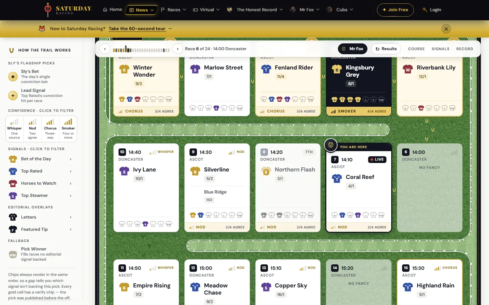
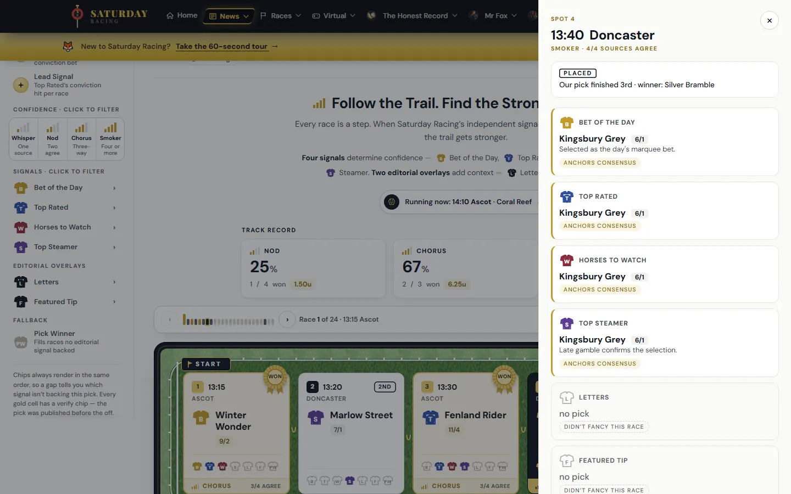
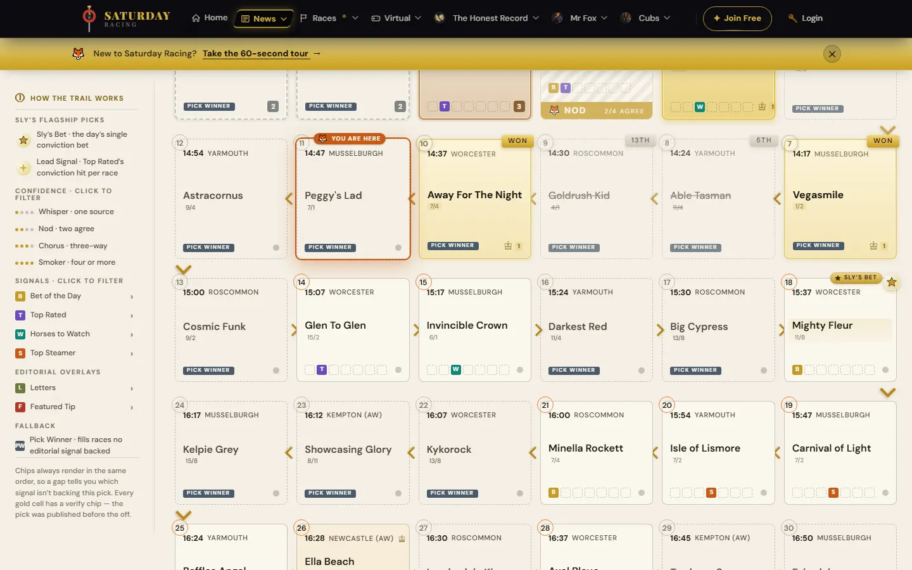
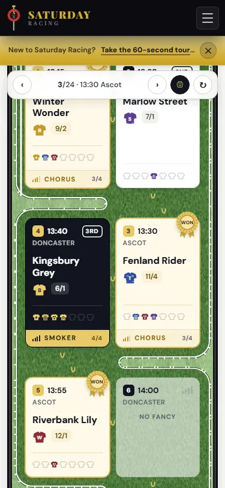
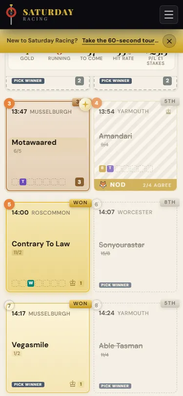

# Fox Trail revamp: feedback

Review of the racecourse board (`feat/trail-racecourse`, merged as `d3a6abd`
on 6 October 2026), looked at on 12 October at 1440, 1024, 768 and 375px,
beside the live page at <https://www.saturday-racing.com/trail/>.

**In short:** this is a strong redesign and it is well built. It is not
ready to port yet, because it has only been designed against a 24-race
day and a real day is about twice that. One more round, on the four
points under "Before porting", and it can go.

## What works

- **The concept.** Cards on a grass board, a white-railed track running
  through them from the START flag to the WINNING POST. It reads as the
  same site as the redesigned home page.
- **The cards.** Far clearer than the live ones: a silk per source, the
  confidence footer ("CHORUS 3/4 AGREE"), a rosette on winners, and a
  dark "YOU ARE HERE / LIVE" card that is easy to find.
- **The course bar.** New and useful: the mini-map of the day,
  previous/next, the "Mr Fox" jump to the current race, and the Results
  toggle, all staying under the nav as the board scrolls.
- **The drawer.** A side panel on desktop, a sheet on phones, one block
  per source.
- **The build.** No sideways scrolling and no script errors at any of
  the four widths. CI is green. No `!important`. Reduced motion and
  keyboard focus are handled. Scroll and resize work is throttled and the
  scripts bail cleanly when a hook is missing.

## Before porting

### 1. Design it against a real-sized day

The fixture has 24 races. The live trail on 12 October had **47**.

The new cards are larger, and there are 5 to a row on desktop where the
live page has 6. Estimated from the card sizes, a 47-race day makes the
board about twice as tall as the live one on desktop (about 3,100px
against 1,570px) and about 40% taller on phones (about 6,000px against
4,240px). The course bar's mini-map would need 47 ticks, which will be
tight at tablet width.

Please add a 47-race fixture, add it to `trail-states.html`, and show how
the board and the mini-map hold up. A denser layout for big days is
probably needed.

### 2. A compact card for thin races

On a real day most races are a Pick Winner fallback or a single-source
pick. In the new design those cards are a horse name, a price, a large
white gap and a row of greyed-out silks. The fixture has far more
multi-source picks than a real day does, so the board looks fuller here
than it will live.

Compare the live page, where most cards are "PICK WINNER":

Please design a shorter card for Whisper and Pick Winner races, and make
the fixture's mix of tiers closer to a real day's.

### 3. Straight order on phones

The live page already snakes on desktop, and that is fine: the track
makes the direction obvious. On phones the live page reads straight
(3, 4, then 5, 6). The new design snakes there too, so with two columns
race 4 comes before race 3, and race 12 before race 11.

Please keep phones in straight reading order. The track can still be
drawn; it just shouldn't reverse the rows.

### 4. The Results toggle misses races that settled while the page was open

Reproduced:

1. Open `http://localhost:8080/trail/live/?sim=reset`, then `trail.html`.
2. Wait about 25 seconds while races settle.
3. Press **Results**.

Result: 8 of 14 settled cards flipped. The six that settled while the
page was open (7, 9, 10, 11, 12, 13) stayed on their picks, although the
button now reads "Picks" and `aria-pressed` is true.

Cause: `trail_flip.js` flips only `.cell[data-settled="1"]`
(`trail_flip.js:41`), and `trail_live.js` never sets `data-settled` when
it settles a cell. `trail_course.js:178` enables the toggle from the
settled *class*, so the two disagree. Neither `trail_flip.js` nor
`trail_live.js` changed in the revamp, so production very likely has the
same fault; fix it here and it goes back with the port.

The "morning" test in `tests/trail.spec.js` runs with `live: false`,
which is why it doesn't catch this. Please add one that settles a race
by poll and then presses the toggle.

## Smaller points

These can be fixed in the same round or during the port.

- **The board starts lower.** The introduction and the track record now
  sit above it: the first card is about 750px down on desktop (about
  560px live) and about 1,040px on phones (about 750px live). A regular
  scrolls past the explainer on every visit. Consider collapsing it for
  returning readers, or moving the track record below the board.
- **Course bar buttons are 32×32px on phones.** About 44px is the
  comfortable size for a thumb.
- **Previous/Next disable themselves while focused**
  (`trail_course.js:188-189`). At the last race the focused button
  becomes `disabled` and a keyboard user can lose their place. Use
  `aria-disabled` and do nothing on press.
- **Arrow keys act with nothing focused** (`trail_course.js:342-357`).
  If any part of the board is on screen, Left or Right jumps the page to
  a card. Only act when focus is inside the board or the course bar.
- **"No current race" is read as "the day is over"**
  (`trail_course.js:151-157`, `trail_track.js:106-111`). If the server
  ever sends today with no `cell--now`, the call says "The day is run"
  and every hoof print goes gold. Please confirm when `is_now` can be
  absent, and handle "between races" separately from "finished".
- **The snake depends on each card's position in the grid**
  (`trail.css:1707-1745`, `:nth-child`). Any other element inside
  `#trailGrid` in the Django template shifts every reversed row. Note it
  in `integration-map.md`, or key the rows off `data-cell-index`.
- **Hover styles on the course bar are not guarded**
  (`trail.css:1421`, `:1523`, `:1545`), so they stick after a tap on a
  touch screen. `.cell:hover` is already inside `@media (hover: hover)`;
  do the same for these.
- **Sample text only the script corrects.** "24", "13:15 Ascot" and
  "Running now: 14:10 Ascot · Coral Reef" in `trail.html` must be
  rendered by the template. `integration-map.md` covers this; it is
  listed here so it isn't missed.

## Not reviewed

The meeting page (PR #8, merged 11 October) is not covered here.
