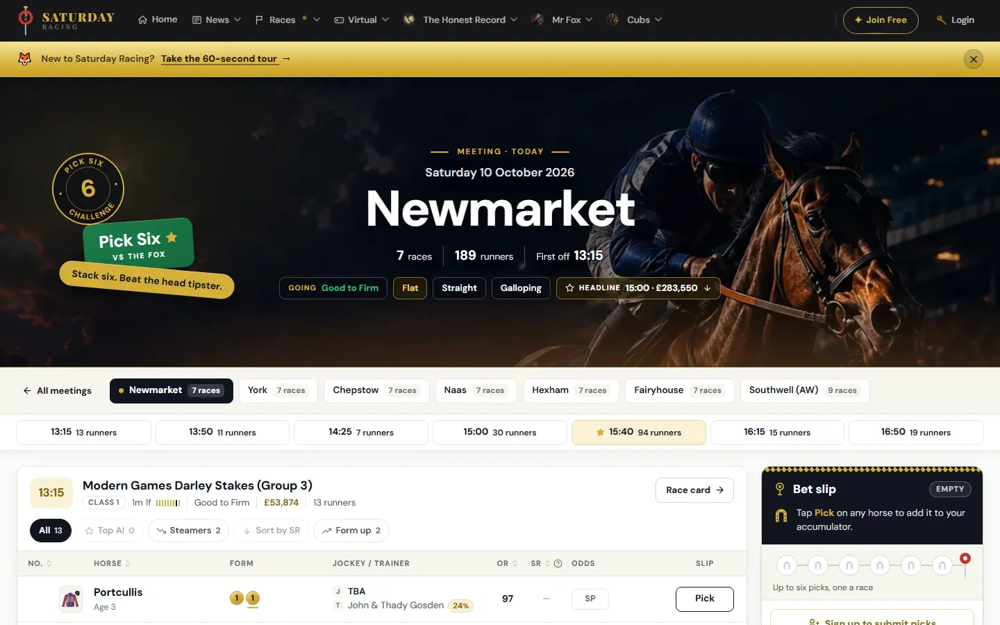
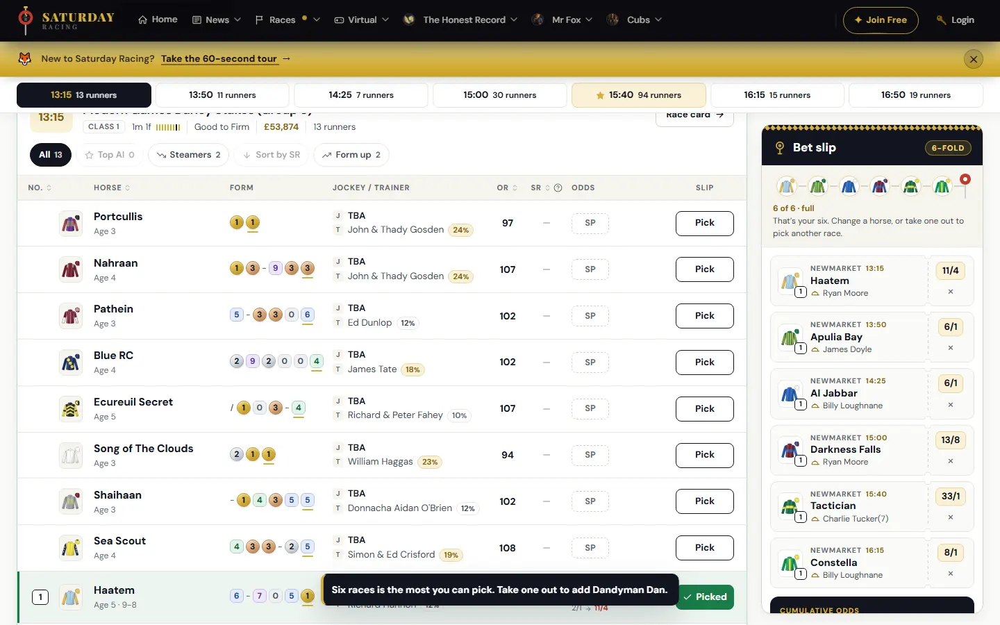
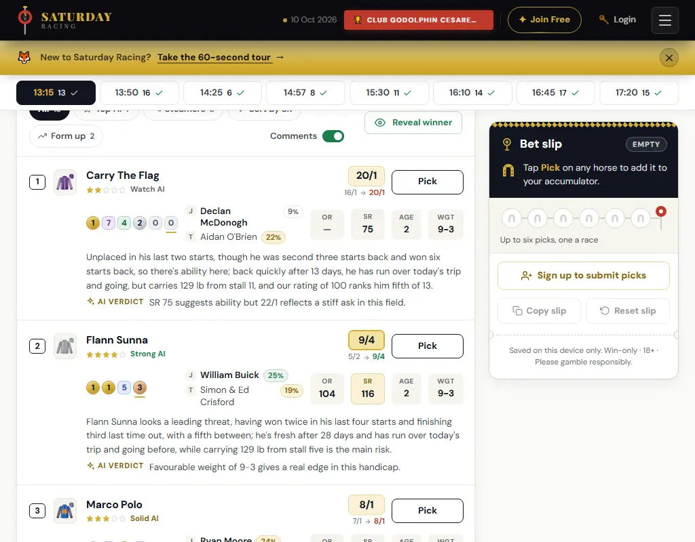
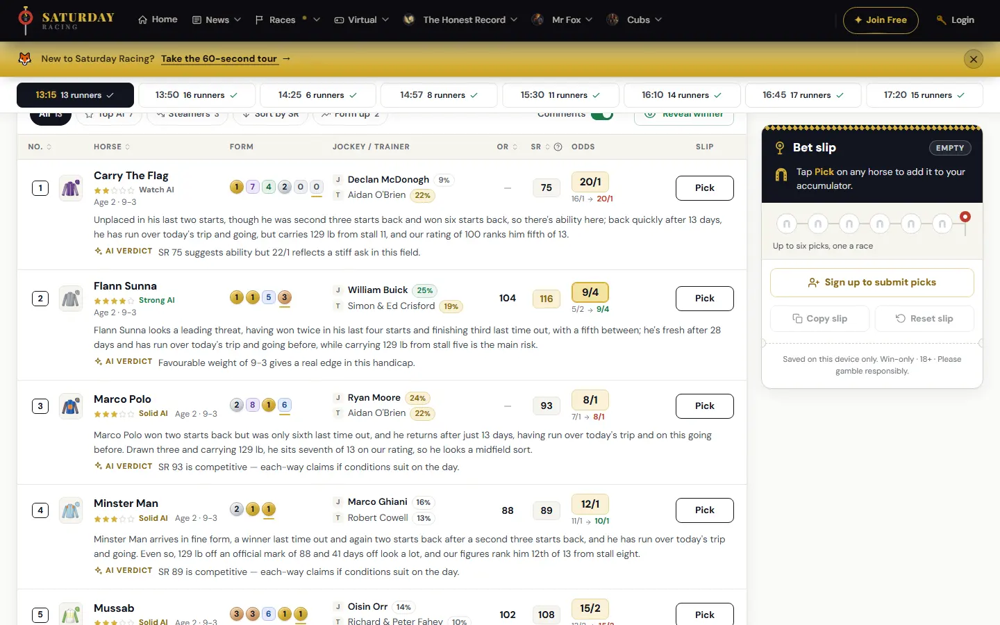
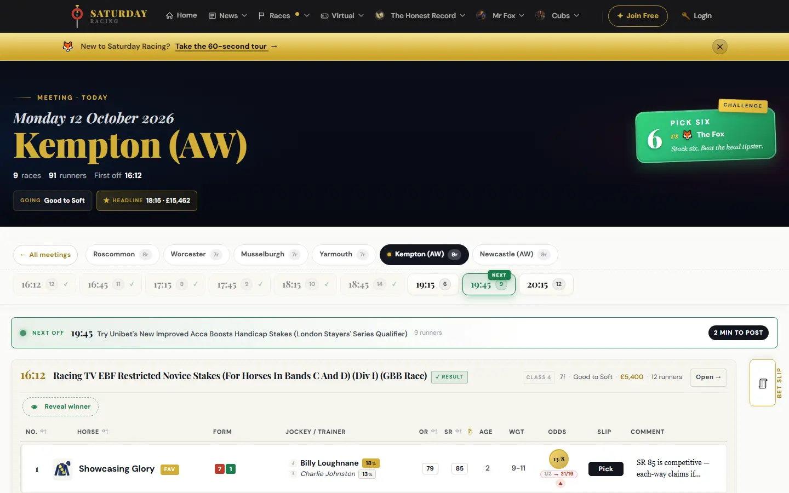
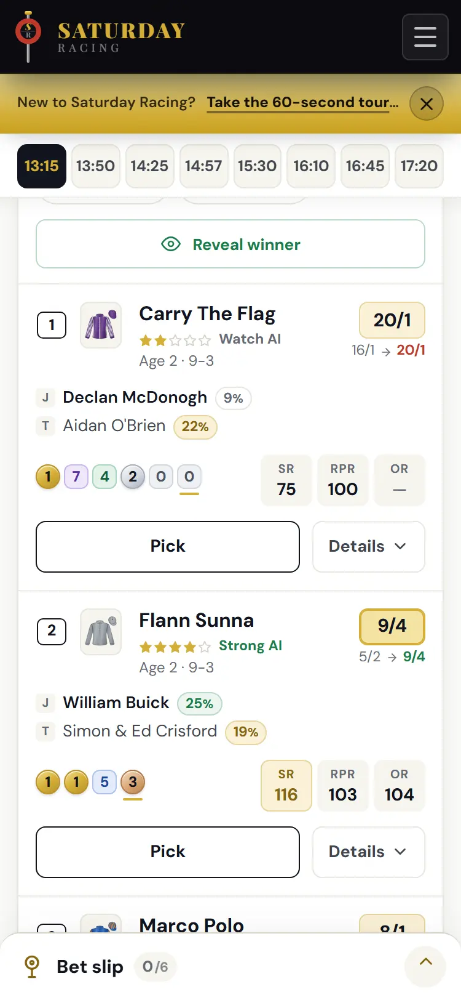

# Meeting page revamp: feedback

Review of PR #8 (`feat/meeting-full`, merged as `0df61d2` on 11 October
2026), looked at on 12 October at 1440, 1024, 768 and 375px on both
captured days, beside the live page at
<https://www.saturday-racing.com/races/meeting/kempton-aw/2026-10-12/full/>.

> **Update, 12 October.** Points 1 and 3 and the smaller points in the
> scripts and the stylesheet have since been dealt with in
> `fix/meeting-before-port`; this page is kept as feedback. Point 2 (the
> states the two days do not have) and the OR sort are being settled in
> the port, against the app's own templates.

## Overall: 8 / 10

A good redesign, well built and well handed over. Three things stand
between it and the live site, and none of them is serious: the Pick
button on a runner with no price, the states the two captured days do
not have, and how long the page runs at laptop width.

| Area | Grade | Why |
| --- | --- | --- |
| **Visual design** | **8.5** | The same site as the home page and the trail. The masthead, the form in a colour a place, the prices and the slip as a betting ticket are all a clear step up from the live page |
| **Following the brief** | **9** | Nothing removed. The four production scripts come back byte for byte; everything new is in three scripts and one stylesheet beside them. Scoped commits, each saying what it did |
| **JavaScript** | **8.5** | The six-pick limit could not be got round: keyboard, double clicks, a slip restored from another tab, take one out and put one in. New storage access is guarded; scroll and resize are throttled. Marked down for the focus lost when the sheet closes, and the whole ticket rebuilt on every keystroke in the stake |
| **CSS** | **8** | No `!important`, the site's tokens, container queries where the room is the list's and not the window's. Marked down for the unpriced button (below), hover rules not kept to pointers that hover, and small touch targets |
| **Accessibility** | **7.5** | Focus styles on every new control, `aria-pressed` on the filters, a real switch, reduced motion honoured. Marked down for the lost focus, targets under 44px on a phone, and a refusal that is not announced the second time |
| **States and tests** | **6.5** | 20 states and 37 tests is a lot. But both days have a Pick on every runner, and neither has a race in progress, a closed race, a non-runner or a member's Submit: styles written for markup they have never met, and a test that says every runner has a Pick, which the live page does not |
| **Fitting real days** | **6.5** | Fine at 1440px and on a phone. At 1024px a 13-runner race is about 3,500px, nearly a phone's length on a laptop |
| **Handoff** | **9.5** | CI green on all three checks, a PR description that says what changed and why, a brief, porting notes, the trade-offs written down. This is how to hand work over |

## What works

- **The slip.** Docked beside the races from 1024px and always in view,
  where the live page keeps it behind a small tab. Each pick is a ticket
  with the runner's silks, jockey and price; six places fill along the
  top. On a phone it is a bar at the foot of the screen that opens as a
  sheet.
- **The six-pick limit.** Seven races picked in turn: the seventh is
  refused with "Six races is the most you can pick. Take one out to add
  Dandyman Dan." The gate is a capture-phase listener, so `bet_slip.js`
  never hears the press, and it is documented as a trade-off. The
  server keeps the limit too.
- **The runners.** Form coloured by finishing place, prices on a tint
  with the favourite a shade deeper, the filters at every width.
- **The states nobody could see.** The live page's "Next off" bar and a
  non-runner's row were put into the new design to check: both are
  styled, and look right. That is careful work on markup the captures
  did not have.

## Before porting

### 1. A Pick that cannot be picked looks like one that can

On the evening before, 121 of the 189 runners have no price. Their Pick
buttons look exactly like the rest; pressing one only says "No priced
market for this runner yet." The template gives those buttons
`racecard__slip-btn--unpriced` and the live page greys them;
`meeting.css` has no rule for the class. With the slip full they are
also the only buttons that still look ready, because the stand-down
skips them (`meeting_slip.js:359`).

To see it: open `meeting-upcoming.html` and press Pick on the first
runner of the first race.

### 2. The states the two days do not have

Both captures have a Pick on every runner (100 of 100, 189 of 189).
Neither has:

- a race in progress, with the "Next off" bar and its countdown;
- a closed race, where the template leaves the button out altogether;
- a non-runner (`data-nr="1"`), which also has no button;
- a signed-in member, with `#slipSubmit` and the undo banner.

`integration-map.md` says every template state bar "running now" is
covered. The styles for these are there, and the two checked by hand
look right, but none is on `meeting-states.html` and none is tested.
`tests/meeting.spec.js:56` asserts a Pick on every runner, which will
not hold on a real afternoon.

Please capture a day partway through its card and add those states.
This is the same lesson as the trail's 24-race fixture: what is not on
the screen while designing is where the rework comes from.

### 3. A laptop's length

At 1024px the docked slip leaves the race list 676px, which puts it in
the two-lines-a-runner layout: 230 to 275px a runner with the comments
on. At 1440px a runner is 150 to 170px; on the live page, where the
comment is one cut-off column, about 90px.

The Comments switch already folds them away. At laptop width they
should start folded.

## Smaller points

- **Focus is lost when the sheet closes** (`meeting_slip.js:93-99`).
  Escape with the focus in the stake field drops it to `<body>`. Put it
  back on the handle. The race strip's links likewise scroll to a race
  without moving the focus there (`meeting_masthead.js:175-185`).
- **Touch targets on a phone.** Taking a pick out is 34×30px
  (`meeting.css:4838`), the filters are 34px tall (`:1746`), Pick is
  42px on the card (`:3258`) and 36px on a tablet (`:2612`). 44px is the
  size to aim for.
- **Hover rules.** 41 of them, none inside `@media (hover: hover)`, so
  the wash on Pick stays after a tap.
- **Every keystroke in the stake rebuilds the ticket**
  (`meeting_slip.js:340`, off `bet_slip.js`'s `render()`): the silks are
  made again, the kit is written to storage again (`:247`) and every
  Pick button is walked. Only do the work when the picks have changed.
- **The refusal is not announced twice** (`meeting_slip.js:378`): the
  same text set again in a `role="status"` says nothing. Clear it first.
- **With six picks the stake and the returns are under the tickets**,
  and the slip scrolls inside itself to reach them: 523px showing of
  1,094 on a 720px-high laptop.
- **Sorting by OR does nothing.** The head has `data-col="or"` and no
  row has `data-or`, so the arrow turns and the rows stay
  (`racecard.js:137-139`). This is the production script's fault, not
  the revamp's, but the keyboard sort makes it easier to find.
- **`bet_slip.js:101,108` read storage without a guard.** Also
  production's. If storage throws, nothing on the page is bound, while
  the new card still says "Up to six picks".

## What to take from it

The build and the handoff are the standard to keep. The one habit to
add: before calling a page done, list every branch the template has
(`` by ``) and make sure each one is on the states page.
The two captured days were a good start; a third, taken mid-afternoon
and signed in, would have found the first two points here.
